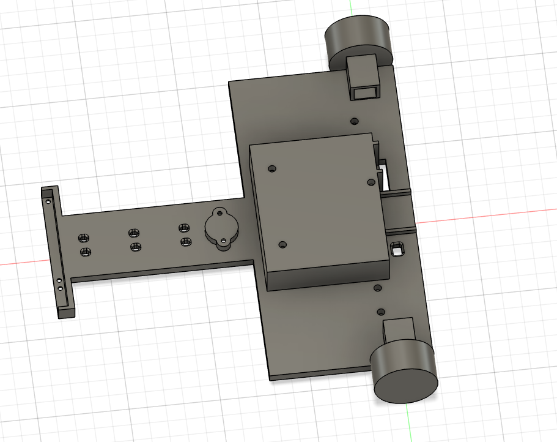
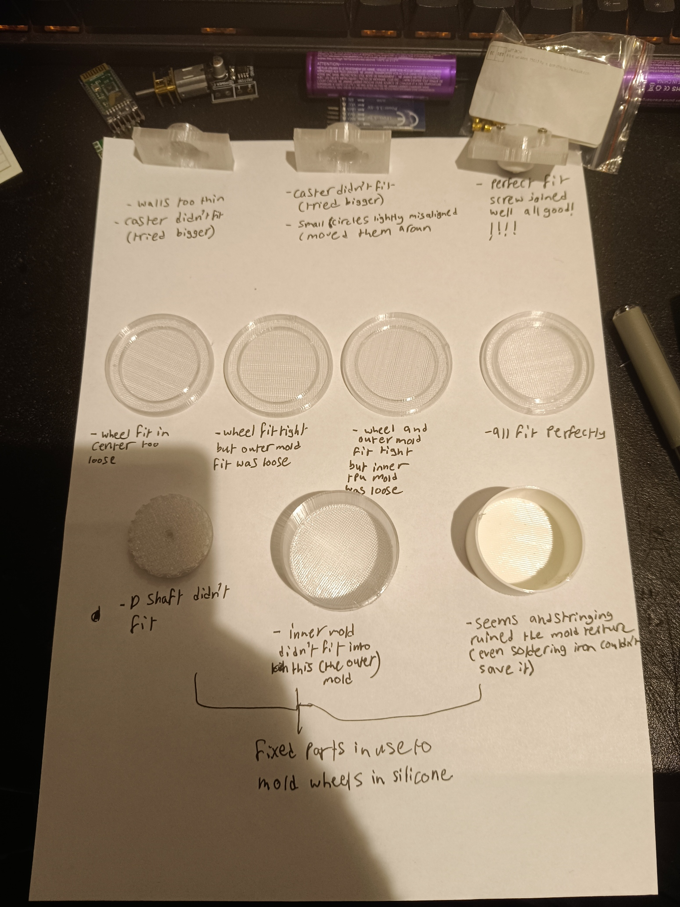

# November 1st: received components
)
)
)

i also got 3x 18650 3.7v 20A max continuous discharge 3000 mAh efest batteries(very cool)
1 kg creality transparent petg filament.
# November 5th: designed the schematic on kicad and the wheel and the mold used to mold the silicon around the wheel.
Opened up kicad and connected all the components to get an image to refrence when wiring and an idea of how to incorprate wire paths 
on the 3D CAD design for the main body of the line follower. added a voltage divider to know the output voltage of the 18650 batteries
as they sag overtime and balance it out in code.

**Total time spent: 2 hours**

# November 6th: designed main body of line follower
used fusion 360 and all of the components in my hand to design space for the 3x 18650 batteries, stm32 nucleof401re, hc-05 bluetooth module,
QTR 8A infrared sensor, 2 custom silicon molded wheels, n20 12v 2000 rpm motors, 2 DRV8871 motor driving module, buck converter and a ball caster.
i used brass heat inserts to thread m3 nuts and hold the development board, battery and driver modules.

**Total time spent: 2 hours**

# November 6th: adjusted the body dimensions
yesterdays main body was complex but vague. the dimensions of the holes and shapes where mostly estimates to get a better overall view and catch any inherent
flaws in the design before committing full detail. today i committed full detail as much as i can and started testing. for context the wheel molding includes an outer petg frame an inner tpu cylinder which acts as the actual mold. the petg frame supports and prevents the inner tpu mold from flexing and ruining the wheel shape. the lid holds the petg wheel core tightly and suspends it in the middle of the 2 molds with its inner rim tightly fitting with the tpu inner mold and the outer rim fitting tightly with the outer petg frame. the main robot body has a caster slot which allows the free moving ball caster to both press fit and get screwed on. the wheel petg core has a D slot for the D shaft of the N20 motor. todays tolerance tests:
fixed the caster within 3 iterations
fixed the lid with 2 rims within 4 iterations
fixed the d shaft within 2 iterations
fixed the tpu and petg frames within 2 iterations each
all in all tolerance testing took around 1 hour of measurement and tweaking (excluding printing and setup/ debugging time).
detail tweaks before tolerance testing took 1 hour so overall 2 hours today with more tolerance testing on the way.

**Total time spent: 2 hours**

