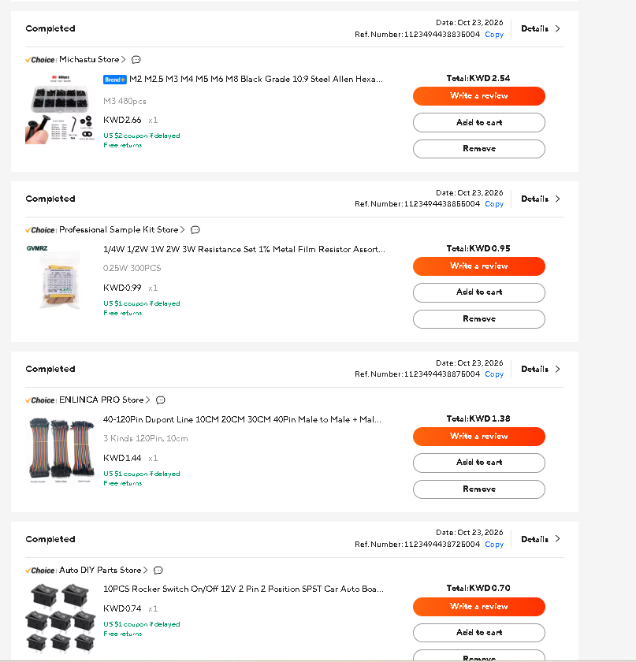
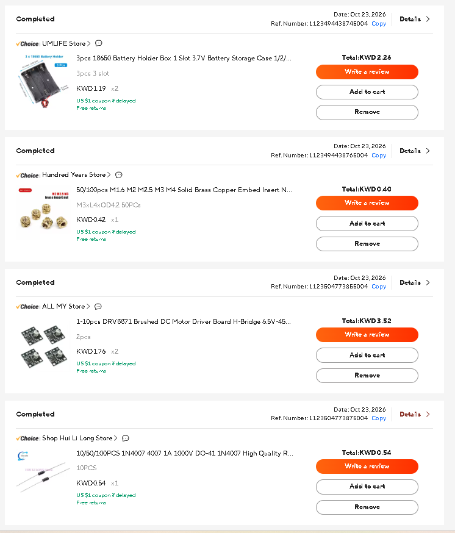
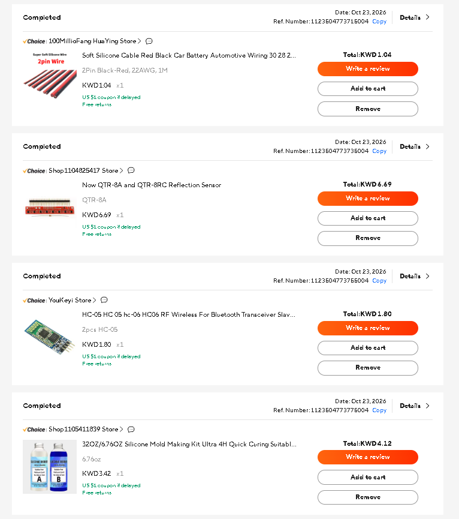
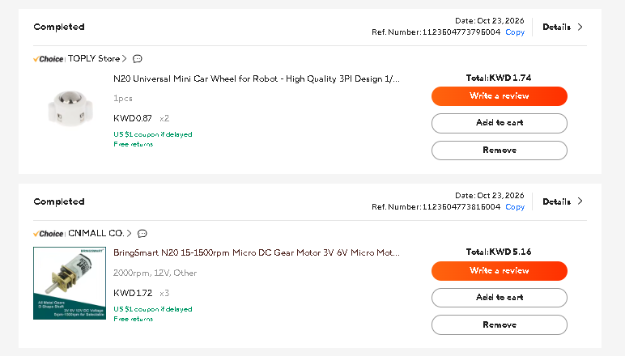
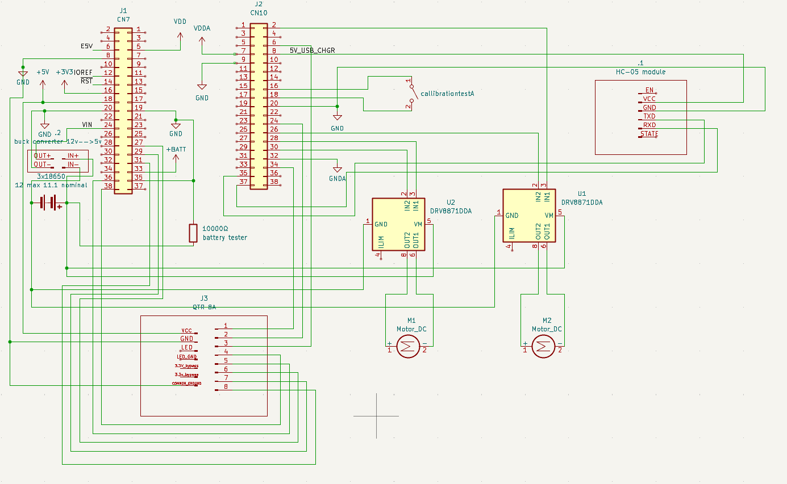
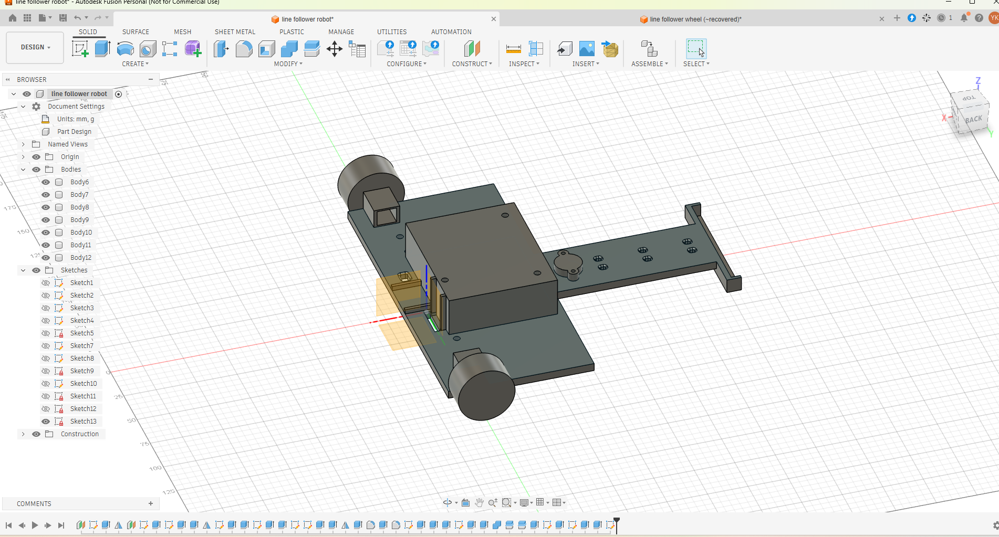

# November 1st: received components
)
)
)

i also got 3x 18650 3.7v 20A max continuous discharge 3000 mAh efest batteries(very cool)
1 kg creality transparent petg filament.
# November 5th: designed the schematic on kicad and the wheel and the mold used to mold the silicon around the wheel.
Opened up kicad and connected all the components to get an image to refrence when wiring and an idea of how to incorprate wire paths 
on the 3D CAD design for the main body of the line follower. added a voltage divider to know the output voltage of the 18650 batteries
as they sag overtime and balance it out in code.

**Total time spent: 2 hours**

# November 6th: designed main body of line follower
used fusion 360 and all of the components in my hand to design space for the 3x 18650 batteries, stm32 nucleof401re, hc-05 bluetooth module,
QTR 8A infrared sensor, 2 custom silicon molded wheels, n20 12v 2000 rpm motors, 2 DRV8871 motor driving module, buck converter and a ball caster.
i used brass heat inserts to thread m3 nuts and hold the development board, battery and driver modules.

**Total time spent: 2 hours**
