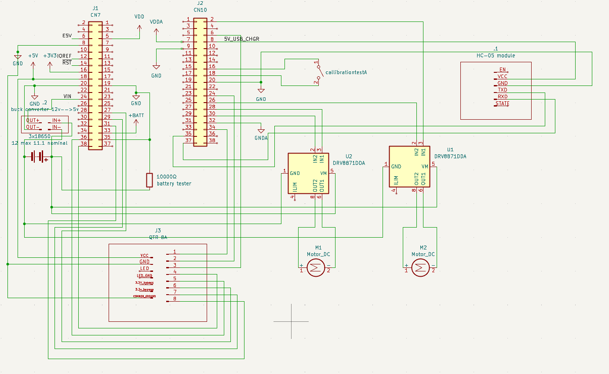
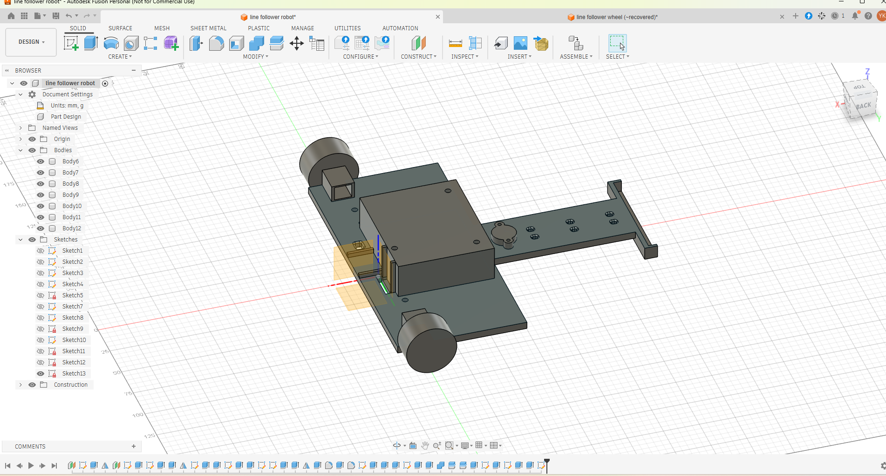
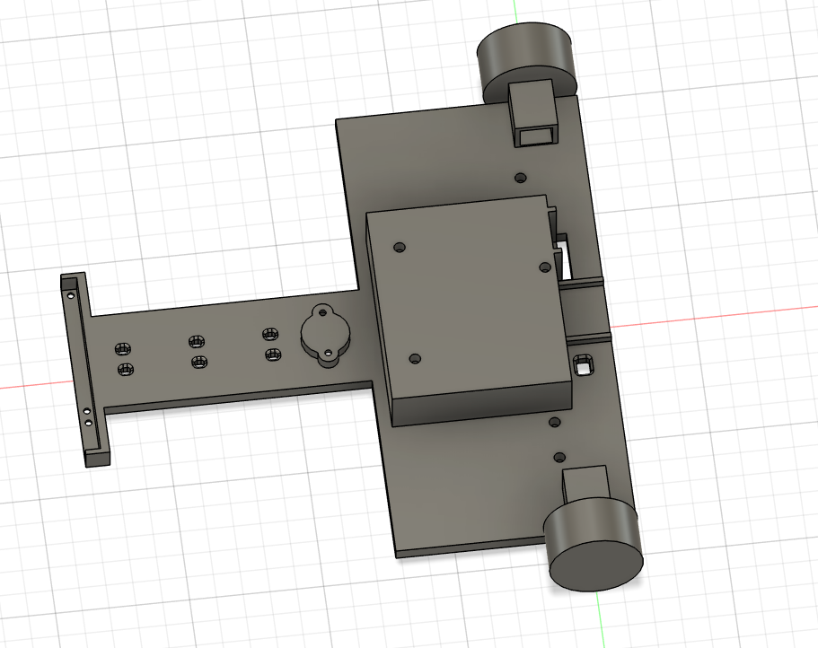
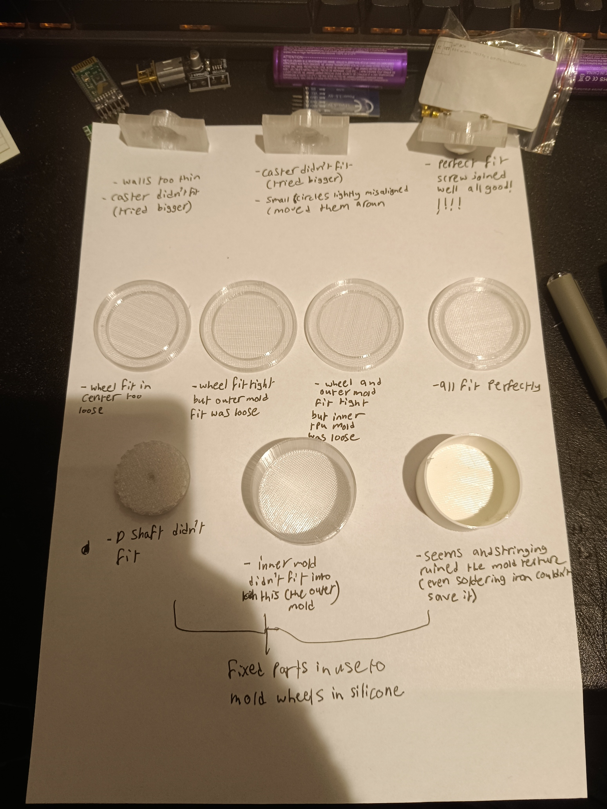
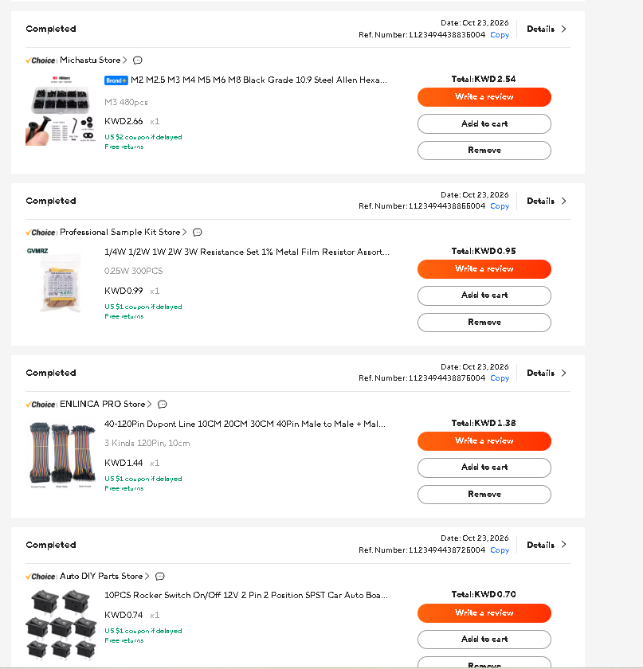
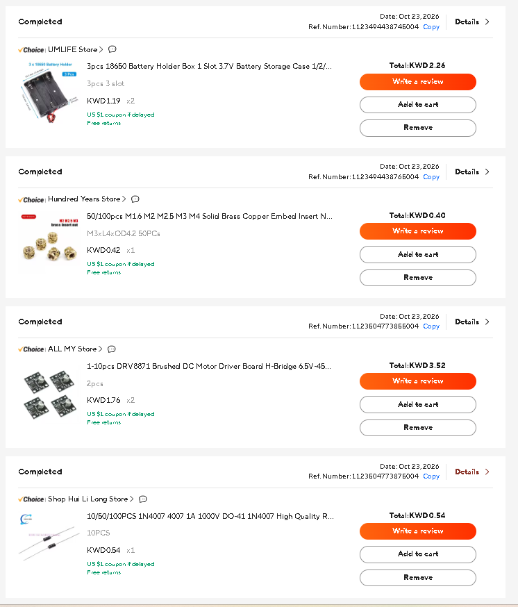
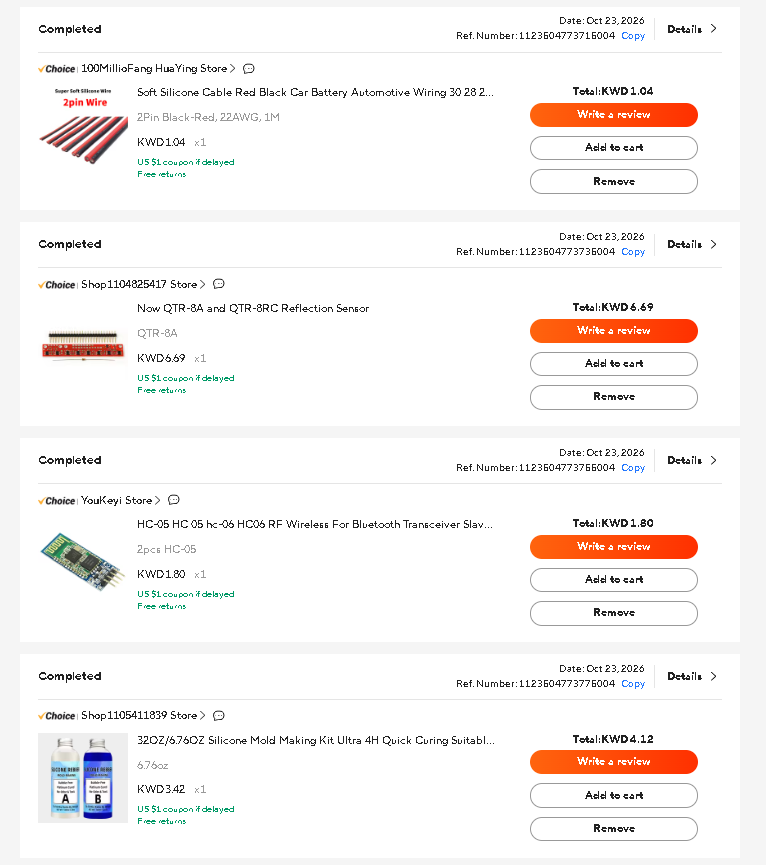
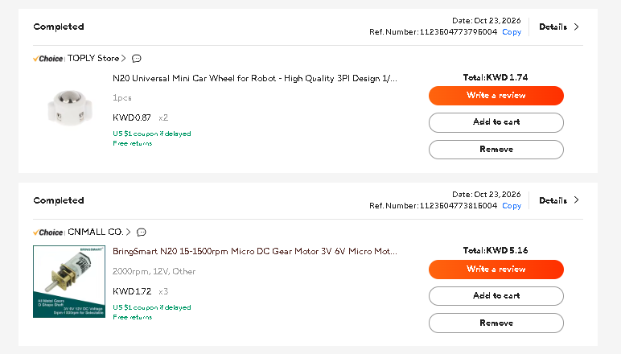

hello my name is youssef kandil i am a 17 year old egyptian living in kuwait. the american university of the middle east is hosting a ROBOTEX event in kuwait and me and 3 of my friends signed up. our school refused to sponsor us so we bought everything out of our own wallets. my goal is to make back some of the money with the help of hackclub and the forge program.

Bill of materials (BOM)

